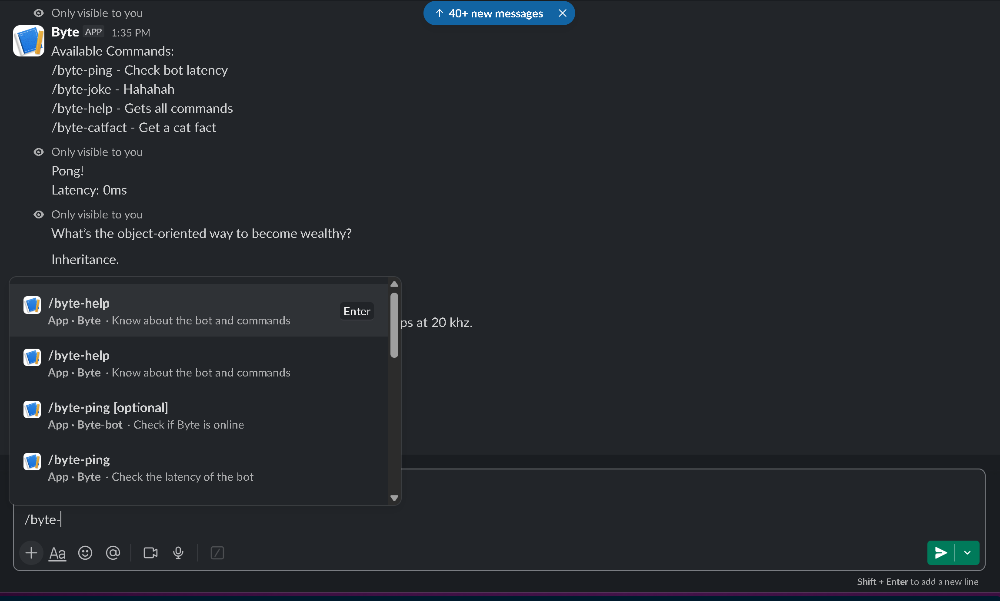

# ⚡ Byte Bot

> A Slack bot running 24/7 which don't slack off even I am slacking off.

---

## 🚀 About the Bot

**Byte Bot** is live **24/7** and active in all channels where invited. It listens and responds directly to slash commands, making it quick and easy to check status, grab a quick laugh, or learn something new.

---

## 💬 Available Commands

Type any of the following slash commands into a channel where the bot is present:

| Command | Description |
| :--- | :--- |
| `/byte-ping` | Checks bot uptime and latency / status |
| `/byte-joke` | Tells a random, clean joke |
| `/byte-catfact` | Fetches an interesting random cat fact |
| `/byte-help` | Displays the help menu with all available commands |

---

## Working preview



## Artificial Intelligence Usage

**Only used ai for some refrence for the search command which is still under development as I am new to javascript**

---

## ⚙️ Getting Started & Hosting

### 1. Clone the Repository

```bash
git clone [https://github.com/ByteCyro/Byte-Bot.git](https://github.com/ByteCyro/Byte-Bot.git)
cd Byte-Bot